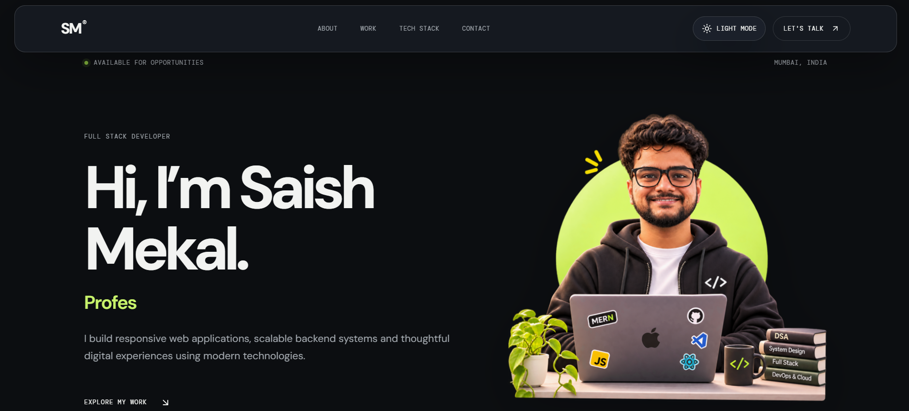

<div align="center">

# Saish Mekal — Developer Portfolio

**From fixing bugs to building things that work.**

A personal corner of the internet where I showcase what I build, what I'm learning, and the technologies I work with.

[Live Portfolio](https://saish-portfolio-psi.vercel.app/)

</div>

---

## 👨‍💻 About

Hey, I'm **Saish**, a Full Stack Developer who enjoys turning ideas into functional, thoughtfully designed digital experiences.

I work on responsive web applications, explore backend technologies, and love figuring out how things work behind the scenes.

This portfolio brings together my projects, skills, and journey as a developer.

## ⚡ Tech Stack

**Frontend**
- React
- TypeScript
- HTML5
- CSS3

**Tools & Technologies**
- Vite
- Git & GitHub
- VS Code
- Vercel

## ✨ Portfolio Features

- Modern, responsive interface
- Dark and light mode toggle
- Interactive project showcase
- Tech stack and about sections
- Contact and social links
- Clean, minimal design

## 🖥️ Preview



## 🚀 Getting Started

Clone the repository:

```bash
git clone https://github.com/saishmekal/Portfolio.git
```

Navigate into the project:

```bash
cd REPOSITORY
```

Install dependencies:

```bash
npm install
```

Start the development server:

```bash
npm run dev
```

## 🏗️ Build for Production

```bash
npm run build
```

## 🌐 Deployment

This portfolio is deployed using **Vercel**.

## 📬 Let's Connect

I'm open to collaborating on interesting projects and exploring new opportunities.

- **GitHub:** https://github.com/saishmekal
- **LinkedIn:** https://www.linkedin.com/in/saish-mekal-64499b253/
- **Portfolio:** https://YOUR-PORTFOLIO.vercel.app

---

<div align="center">

**Mostly fixing bugs I created twenty minutes ago.**

Built with React, TypeScript & a little too much debugging.

</div>
